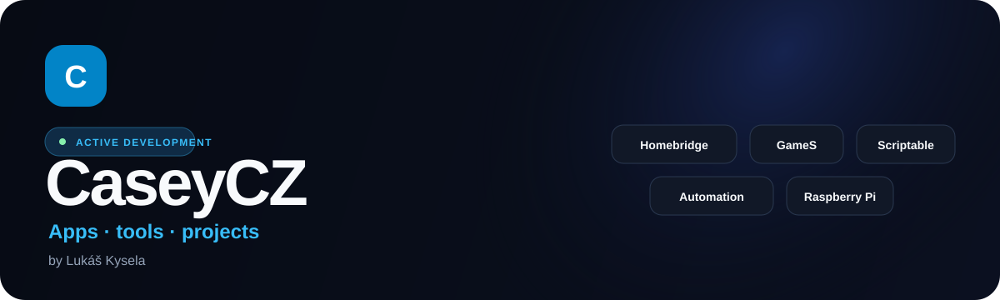

  

  
  

  I build practical apps and tools I want to use myself — for <strong>iPhone, Apple TV, Homebridge, Raspberry Pi, Windows, the web and Stremio</strong>.

  
  
  
  

  

## Current projects

<table width="100%">
  <thead><tr><th width="18%" align="left">Project</th><th width="21%" align="left">Status / version</th><th width="34%" align="left">Info</th><th width="27%" align="left">Links</th></tr></thead>
  <tbody>
    <tr>
<td width="18%" align="left" valign="middle"><strong>HB Control</strong></td>
      <td width="21%" align="left" valign="middle"></td>
      <td width="34%" align="left" valign="middle">Homebridge for iPhone and iPad.</td>
      <td width="27%" align="left" valign="middle">&nbsp;</td>
    </tr>
    <tr>
<td width="18%" align="left" valign="middle"><strong>PiTV</strong></td>
      <td width="21%" align="left" valign="middle">&nbsp;</td>
      <td width="34%" align="left" valign="middle">Raspberry Pi TV system with Waydroid.</td>
      <td width="27%" align="left" valign="middle"></td>
    </tr>
    <tr>
<td width="18%" align="left" valign="middle"><strong>TubeTV</strong></td>
      <td width="21%" align="left" valign="middle"></td>
      <td width="34%" align="left" valign="middle">Apple TV YouTube with TizenTube.</td>
      <td width="27%" align="left" valign="middle">&nbsp;</td>
    </tr>
    <tr>
<td width="18%" align="left" valign="middle"><strong>CorePilot</strong></td>
      <td width="21%" align="left" valign="middle"><code>development</code></td>
      <td width="34%" align="left" valign="middle">Installer for Windows, Linux and macOS.</td>
      <td width="27%" align="left" valign="middle">&nbsp;</td>
    </tr>
    <tr>
<td width="18%" align="left" valign="middle"><strong>GameS&nbsp;Calendar</strong></td>
      <td width="21%" align="left" valign="middle"></td>
      <td width="34%" align="left" valign="middle">Game release calendar powered by IGDB.</td>
      <td width="27%" align="left" valign="middle">&nbsp;</td>
    </tr>
    <tr>
<td width="18%" align="left" valign="middle"><strong>Abaku</strong></td>
      <td width="21%" align="left" valign="middle"><code>web</code></td>
      <td width="34%" align="left" valign="middle">Math game with AI and online play.</td>
      <td width="27%" align="left" valign="middle">&nbsp;</td>
    </tr>
    <tr>
<td width="18%" align="left" valign="middle"><strong>iOS Hub</strong></td>
      <td width="21%" align="left" valign="middle"><code>web</code></td>
      <td width="34%" align="left" valign="middle">AltStore, Feather, FlareStore, Shortcuts.</td>
      <td width="27%" align="left" valign="middle">&nbsp;</td>
    </tr>
    <tr>
<td width="18%" align="left" valign="middle"><strong>Scriptable&nbsp;Apps</strong></td>
      <td width="21%" align="left" valign="middle"></td>
      <td width="34%" align="left" valign="middle">Widgets, Tic-tac-toe, Breakout and Pong.</td>
      <td width="27%" align="left" valign="middle">&nbsp;</td>
    </tr>
    <tr>
<td width="18%" align="left" valign="middle"><strong>iOS&nbsp;IPA&nbsp;Builder</strong></td>
      <td width="21%" align="left" valign="middle"><code>GitHub Actions</code></td>
      <td width="34%" align="left" valign="middle">IPA builds via GitHub Actions.</td>
      <td width="27%" align="left" valign="middle">&nbsp;</td>
    </tr>
    <tr>
<td width="18%" align="left" valign="middle"><strong>Stremio&nbsp;Sosáč</strong></td>
      <td width="21%" align="left" valign="middle"></td>
      <td width="34%" align="left" valign="middle">Stremio catalogs and streaming add-on.</td>
      <td width="27%" align="left" valign="middle">&nbsp;</td>
    </tr>
    <tr>
<td width="18%" align="left" valign="middle"><strong>Sosáč&nbsp;Subtitles</strong></td>
      <td width="21%" align="left" valign="middle"></td>
      <td width="34%" align="left" valign="middle">Subtitles for Stremio and Apple.</td>
      <td width="27%" align="left" valign="middle">&nbsp;</td>
    </tr>
    <tr>
<td width="18%" align="left" valign="middle"><strong>Stremio&nbsp;Addons</strong></td>
      <td width="21%" align="left" valign="middle"></td>
      <td width="34%" align="left" valign="middle">Four independent Stremio source add-ons.</td>
      <td width="27%" align="left" valign="middle"></td>
    </tr>
    <tr>
<td width="18%" align="left" valign="middle"><strong>Travel Checklist</strong></td>
      <td width="21%" align="left" valign="middle"><code>web</code></td>
      <td width="34%" align="left" valign="middle">Travel lists, templates and sharing.</td>
      <td width="27%" align="left" valign="middle">&nbsp;</td>
    </tr>
  </tbody>
</table>

**Other public repositories:** [Browse all projects on GitHub](https://github.com/CaseyCZ?tab=repositories).

## Focus

- 🍎 **iOS / iPadOS / tvOS** — Swift, SwiftUI and native Apple apps
- 🏠 **Homebridge & smart home** — server management, plugins, automation and diagnostics
- 📺 **Raspberry Pi & Linux** — TV environments, servers, Wayland, Waydroid and HDMI-CEC
- 🪟 **Windows & installation tools** — .NET, PowerShell and guarded USB workflows
- ⚙️ **GitHub Actions** — automated builds, release workflows, checks and deployments
- 🌐 **Web & Node.js** — catalogs, APIs, Stremio add-ons and practical web tools

## About me

I'm **Lukáš Kysela / CaseyCZ**. Professionally, I have long-term experience in production planning and SAP. My personal projects focus mainly on practical apps, automation and tools that solve a specific need.

## GitHub activity

  

## Support

  

   
  Scan the QR code or click the button.

## Social

  
  
  

